# Ramayana Yudh — Development Roadmap & Milestone Plan

**Project:** Ramayana Yudh (Browser-based 3D Mythological Action Game)  
**Architecture:** ES Modules, Three.js, Vite, Rapier3D, Native HTML/CSS  
**Status:** Milestones 1 through 5.2 Completed  

---

## 1. Development Philosophy

1. **Strict Milestone-Based Progression:** Features are designed, implemented, and verified in self-contained milestones. No premature gameplay mechanics or speculative code.
2. **Zero Inventions:** All models, rigs, and textures are sourced from inspected, documented assets.
3. **Performance First:** Strict control of draw calls, asset loading budgets, and memory disposal across scene lifecycles.
4. **Resilient Error Handling:** Every network request and 3D asset loader must feature progress callbacks, graceful timeouts, and user feedback.

---

## 2. Milestone Roadmap Overview

```mermaid
flowchart TD
    M1["Milestone 1: Project Foundation & Cinematic Main Menu\n[COMPLETED]"] --> M1_1["Milestone 1.1: Main Menu Visual & UI Refinements\n[COMPLETED]"]
    M1_1 --> M2["Milestone 2: Initial Environment Loading\n[REVISED]"]
    M2 --> M2_1["Milestone 2.1: Pine Forest Replacement & Camera Refinement\n[COMPLETED]"]
    M2_1 --> M3["Milestone 3: Player Hero Controller & Animation State Machine\n[COMPLETED]"]
    M3 --> M3_1["Milestone 3.1: Character Asset Update, Terrain Collision & Lighting\n[COMPLETED]"]
    M3_1 --> M3_2["Milestone 3.2: Final Character & Environment Corrections\n[COMPLETED]"]
    M3_2 --> M3_3["Milestone 3.3: Shri Ram Hair Rendering Correction\n[COMPLETED]"]
    M3_3 --> M4["Milestone 4: Weapon System & Bow Shooting Physics\n[COMPLETED]"]
    M4 --> M4_1["Milestone 4.1: Weapon Alignment, Third-Person Aiming & Shooting Corrections\n[COMPLETED]"]
    M4_1 --> M4_2["Milestone 4.2: Third-Person Aiming & Shooting Refinement\n[COMPLETED]"]
    M4_2 --> M4_3["Milestone 4.3: Correct GTA-Style Over-the-Shoulder Camera Composition\n[COMPLETED]"]
    M4_3 --> M4_4["Milestone 4.4: Rapid-Fire Archery, Projectile Effects & Performance\n[COMPLETED]"]
    M4_4 --> M4_5["Milestone 4.5: Impact VFX Refinement & Aasura Character Integration\n[COMPLETED]"]
    M4_5 --> M5_1["Milestone 5.1: Enemy Optimization & First Battle Wave\n[COMPLETED]"]
    M5_1 --> M5_2["Milestone 5.2: Hit Detection, Spawn Separation & Battle HUD\n[COMPLETED]"]
    M5_2 --> M6["Milestone 6: Divine Abilities, Wave System & HUD Loop\n[NEXT]"]
    M6 --> M7["Milestone 7: Audio, Visual FX, Polish & Final Optimization"]
```

---

## 3. Detailed Milestone Status & Breakdown

### Milestone 1: Project Foundation & Cinematic Main Menu — [COMPLETED]
- [x] **Asset Audit:** Full inspection and creation of `docs/ASSET_REGISTER.md`.
- [x] **Roadmap Creation:** Authoring of `docs/MILESTONE_PLAN.md`.
- [x] **Core Engine Architecture:**
  - `src/core/Renderer.js`: Central Three.js WebGLRenderer, tone mapping, responsive resizing, DPR capping.
  - `src/core/AssetLoader.js`: Unified promise-based GLTF/Texture loader with error catching and progress reporting.
  - `src/core/SceneManager.js`: State-driven scene manager facilitating clean lifecycle management (`init`, `update`, `destroy`).
  - `src/assets/assetManifest.js`: Single source of truth for asset URLs and metadata.
- [x] **Cinematic Main Menu (`MainMenuScene.js`):**
  - Cosmic galaxy sky photosphere with subtle celestial rotation.
  - 3D Shri Ram showcase model positioned gracefully on the right, scaled and centered dynamically.
  - Mythological warm golden key lighting with royal indigo ambient illumination.
  - Floating divine ember/particle system.
- [x] **User Interface (`MainMenuUI.js`):**
  - High-resolution game logo display.
  - Vedic/mythological styled typography and interactive menu buttons: `PLAY GAME` and `SETTINGS`.
  - Settings modal with volume controls, graphics quality selector, and display toggles.
- [x] **Testing & Verification:** Production build verified with Vite, automated headless browser tests passed.

---

### Milestone 1.1: Main Menu Visual & UI Refinements — [COMPLETED]
- [x] **Shri Ram Initial Heading Adjustment:**
  - Set initial yaw heading (`initialRotationY = -0.95` rad / ~-55°) so Shri Ram initially faces slightly away from the camera, displaying his back/side silhouette before smoothly rotating into a front-facing/three-quarter presentation.
- [x] **Celestial Galaxy Photosphere Background Fix:**
  - Root cause diagnosed: The GLB root node had an embedded scale of `~308.78`. Applying an additional `600x` scale placed vertices at `185,000+` units, far past the camera's far clipping plane (`2000`), causing it to be culled as black.
  - Fix applied: Removed excess multiplier (`scale.setScalar(1.0)`), extracted embedded emissive texture into an unlit `MeshBasicMaterial` with `THREE.SRGBColorSpace`, `THREE.BackSide`, `depthWrite: false`, and `renderOrder: -1000`. The galaxy starfield is now clearly visible.
  - Particles retained as complementary floating divine dust embers.
- [x] **UI Polish & Development Information Removal:**
  - Removed "MILESTONE 1: TECHNICAL FOUNDATION" and "THREE.JS · RAPIER3D · VITE" from the game interface.
  - Cleaned up layout to present only the in-universe logo, Sanskrit shloka (*« यतो धर्मस्ततो जयः »*), and navigation buttons.

---

### Milestone 2: Gameplay Environment Loading — [REVISED]
- **Status:** Initial loading pipeline implemented, but active environment asset superseded due to high draw call overhead (3,687 meshes) and foreground sphere occlusion issues. Revised in Milestone 2.1.

---

### Milestone 2.1: Environment Replacement & Camera Refinement — [COMPLETED]
- [x] **Pine Forest Asset Integration:**
  - Extracted and staged `pine_forest.glb` (5.59 MB) from `Assets/Enviornment/pine-forest.zip` to `public/assets/Environment/pine_forest.glb`.
  - Removed old landscape asset from active loading manifest and runtime pipeline.
  - Verified 3 discrete meshes: `pine1` (pine trees), `obj1` (forest floor), `obj2` (inward-facing sky dome).
- [x] **Sky Dome & Scale Correction:**
  - Diagnosed that `obj2` is an inward-facing sky sphere (radius 70.64m).
  - Configured `obj2` with `renderOrder: -1000`, `depthWrite: false`, and double-sided unlit `MeshBasicMaterial` so it encloses the forest without occluding trees or terrain.
  - Eliminated bounding-box vertical offsets so the ground sits naturally at `y = 0`.
- [x] **Human-Level Camera Positioning:**
  - Positioned camera inside the pine forest clearing at natural eye level (`x = 2.5m, y = 2.58m, z = 5.92m`, looking towards `(0, 1.6, 0)`).
  - Forest floor and surrounding pine trees are clearly framed upon entry.
- [x] **Simple Mouse Camera Controls:**
  - Left-click horizontal mouse drag smoothly orbits camera left and right around the clearing pivot.
  - Automatic idle rotation and cinematic drift completely disabled.
  - Vertical tilt clamped around eye level; zoom strictly bounded between 3m and 14m.
- [x] **Minimal In-Universe Interface:**
  - Removed all development badges, FPS telemetry, and mesh count indicators.
  - Retained location title ("DANDAKARANYA FOREST"), Sanskrit subtitle, controls hint, and "RETURN TO MAIN MENU" button.
- [x] **Testing & Verification:**
  - Production build succeeds (`npm run build`).
  - Headless Chrome CDP test confirmed 0 errors, camera stability, horizontal drag rotation, and return navigation.
  - Gameplay screenshot archived: `tests/pine_forest_gameplay.png`.

---

### Milestone 3: Shri Ram Player Controller & Animation System — [COMPLETED]
- [x] **UI Polish & Toast Notification System:**
  - Removed permanent centre-screen camera helper text.
  - Built reusable, unobtrusive `ToastManager.js` adhering to strict contrast rules (bottom safe area, dark translucent backdrop, zero border cards, auto-dismiss in 4.5s).
  - Implemented top gradient overlay and gentle fade-out for location title.
  - Triggered brief, elegant controls prompt on entry: `WASD — Move • Mouse — Look • SHIFT — Run • ESC — Unlock Mouse`.
- [x] **Character Asset & Rig Integration:**
  - Staged and loaded `Shree_Ram_-_Royal_Warrior.fbx` (69 bones, 15 embedded animations).
  - Scaled by `0.01` to establish authentic human scale ($1.93\text{m}$ height).
  - Enabled soft shadow casting and receiving on character SkinnedMesh.
- [x] **Animation State Machine (`AnimationManager.js`):**
  - Managed via `THREE.AnimationMixer` with smooth $0.22\text{s}$ cross-fading.
  - Active states: `idle`, `walk` ($2.5\text{ m/s}$), `run` ($6.0\text{ m/s}$), and `jump`.
  - Immediate stop and cross-fade to `idle` upon releasing movement keys.
- [x] **Third-Person Follow Camera & Pointer Lock (`PlayerController.js`):**
  - Smooth third-person orbital camera following Shri Ram's upper torso.
  - Pointer lock mouse controls with pitch/yaw clamping and zoom boundaries ($2.4\text{m}$ to $6.2\text{m}$).
  - Dynamic ground clearance clamping preventing camera from penetrating hills.

---

### Milestone 3.1: Character Asset Update, Terrain Collision & Lighting — [COMPLETED]
- [x] **Reload Updated Shri Ram Character Asset:**
  - Replaced staged `public/assets/Ram/Shree_Ram_-_Royal_Warrior.fbx` (11,027,004 bytes) with latest modified source.
  - Preserved natural warm human complexion, jewelry, quiver, ornaments, 69 bones, and 15 animations.
  - Configured un-tinted pure diffuse color (`0xffffff`) and `sRGBColorSpace` across all 18 materials.
  - Set natural PBR roughness ($0.60$) and metalness ($0.05$) avoiding artificial dark blue/black tint or plastic sheen.
- [x] **Rapier3D Forest Terrain Physical Collision:**
  - Extracted exact terrain geometry `obj1` from `pine_forest.glb` (94 vertices, 144 triangles, elevation $-0.51\text{m}$ to $+1.88\text{m}$).
  - Created static Rapier3D trimesh collider via `PhysicsWorld.createTerrainTrimesh()`.
  - Replaced flat ground plane and artificial height clamps with true geometric physical terrain.
- [x] **Dynamic Grounding & Slope Navigation:**
  - Initial spawn elevation at origin $(0, 0)$ set to exact ground level $y = -0.312\text{m}$ (zero floating, zero sinking).
  - Configured Rapier Kinematic Character Controller with autostep ($0.35\text{m}$), snap-to-ground ($0.6\text{m}$), and slope climb ($55^\circ$).
  - Implemented exact downward raycasting in `PhysicsWorld.getTerrainElevation()` with player collider exclusion filter.
  - Uphill movement verified: elevation climbed smoothly from $-0.312\text{m}$ to $-0.059\text{m}$ with millimeter ground contact ($0.000\text{m}$ diff).
  - Downhill movement verified: descended smoothly without floating or snapping.
  - Slope stopping stability verified: position variance $< 0.18\text{ mm}$, zero drift, zero sinking, zero jitter.
  - Maintained forest clearing boundary constraint ($R \le 23.5\text{m}$).
- [x] **Atmospheric Forest Lighting Hierarchy:**
  - Warm golden directional sunlight ($0xfff5e0$, intensity $3.4$, soft PCF shadows, shadow bias $-0.0004$).
  - Hemisphere ambient sky/ground fill ($0xdef0ff$ / $0x4d5d36$, intensity $1.8$) illuminating foliage and shaded areas under pine branches.
  - Ambient light ($0x556075$, intensity $1.2$) ensuring shadow readability.
  - Subtle rim/back fill light ($0xffe6cb$, intensity $1.1$) highlighting character silhouette and pine needles against dark forest backdrop.
- [x] **Testing & Verification:**
  - Production build succeeds with 0 errors (`npm run build`).
  - Automated headless Chrome CDP test (`tests/test_milestone_3_1.mjs`) verified:
    - 0 errors, 18 materials, 16 sRGB textures, untinted diffuse color.
    - Exact spawn elevation $y = -0.312\text{m}$ ($0.019\text{ mm}$ tolerance).
    - Uphill and downhill transitions with `isGrounded: true`.
    - Slope stopping variance $< 0.18\text{ mm}$.
    - Screenshots captured and archived: `gameplay_m3_1_grounded.png`, `gameplay_m3_1_uphill.png`, `gameplay_m3_1_lighting.png`.

---

### Milestone 3.2: Final Character & Environment Corrections — [COMPLETED]
- [x] **Priority 1 — Restored Embedded Sky Panorama & Outdoor Daylight Environment:**
  - Diagnosed that `obj2` in `pine_forest.glb` has inward-pointing normals; configured `side: THREE.DoubleSide`, unlit `MeshBasicMaterial`, `depthWrite: false`, `renderOrder: -1000`, `fog: false`, and `toneMapped: false` with `sRGBColorSpace`. Sky panorama renders in background behind pine foliage without occlusion or darkness.
  - Eliminated pitch-black tree canopies by removing excessive metalness (`metalness: 0.05`, `roughness: 0.75`, `side: THREE.DoubleSide`, `alphaTest: 0.30`). Foliage reflects natural daylight.
  - Calibrated natural outdoor lighting hierarchy:
    - Warm sunlight: $0xfff6e8$, intensity $3.2$, soft PCF shadows (`bias: -0.0003`).
    - Canopy hemisphere fill: $0xd8eeff$ (sky) / $0x55683e$ (moss/earth bounce), intensity $1.9$.
    - Ambient fill: $0x6a788c$, intensity $1.4$, ensuring dark areas under branches remain rich and legible.
    - Back-rim light: $0xffeedb$, intensity $1.0$, accentuating character and pine needle outlines.
- [x] **Priority 2 — Reloaded Latest Shri Ram Character Asset (Hairstyle & Skin Complexion):**
  - Copied latest source [`Assets/Ram/Shree_Ram_-_Royal_Warrior.fbx`](file:///d:/Ramayana/Assets/Ram/Shree_Ram_-_Royal_Warrior.fbx) (11,395,916 bytes) to [`public/assets/Ram/Shree_Ram_-_Royal_Warrior.fbx`](file:///d:/Ramayana/public/assets/Ram/Shree_Ram_-_Royal_Warrior.fbx).
  - Verified SHA-256 hash match: `8ED727A7AEC7B84A1EF4781EAA096963A1A7D0065455BFB1004ECDC98C0D1998`.
  - Added cache-busting version query string (`?v=3.2`) to [`src/assets/assetManifest.js`](file:///d:/Ramayana/src/assets/assetManifest.js).
  - Verified updated short hairstyle (`hair_short01` texture on `Hair` material, roughness $0.70$, metalness $0.05$).
  - Preserved natural warm human complexion (`skin_old_caucasian_male` texture, pure un-tinted diffuse color `0xffffff`, roughness $0.58$, metalness $0.02$).
  - Preserved all 69 bones, 15 embedded animations, and character dimensions ($1.95\text{m}$ height at $0.01$ scale).
- [x] **Priority 3 — Improved Walkable Slope Traversal & Multi-Directional Navigation:**
  - Diagnosed root cause of slope blocking: 0.35m capsule radius caused outer rim penetration on triangle edges ($toi = 0$).
  - Calibrated human capsule radius to $0.28\text{m}$ (halfHeight $0.58\text{m}$, center offset $0.86\text{m}$).
  - Configured Rapier character controller with 2cm clearance skin (`offset = 0.02`), autostep ($0.40\text{m}$), max slope climb angle ($65^\circ$), and snap-to-ground ($0.65\text{m}$).
  - Enhanced ground elevation conforming via `Math.max(nextPos.y, groundInfo.y + offset)` during movement, preventing micro-rim penetration into inclines.
  - Verified traversal across all 16 radial directions ($0^\circ$ to $337^\circ$) to radius $20\text{m}-25\text{m}$ with zero blocking.
  - Verified slope stopping stability: position variance across idle frames measured at **0.1552 mm**.
- [x] **Testing & Verification:**
  - Production build verified (`npm run build`) in $3.74\text{s}$ with 0 errors.
  - Automated headless Chrome CDP test ([`tests/test_milestone_3_2.mjs`](file:///d:/Ramayana/tests/test_milestone_3_2.mjs)) completed with 0 errors.
  - 4 high-resolution verification screenshots captured and archived:
    - `gameplay_m3_2_wide_daylight.png`: Restored daylight forest with visible sky panorama and naturally lit pine canopies.
    - `gameplay_m3_2_closeup_hair_skin.png`: Close-up of Shri Ram showing updated hairstyle and natural complexion.
    - `gameplay_m3_2_uphill_slope.png`: Shri Ram walking smoothly up an uphill slope.
    - `gameplay_m3_2_standing_uneven.png`: Shri Ram standing solidly on uneven terrain with 0 jitter.

---

### Milestone 3.3: Shri Ram Hair Rendering Correction — [COMPLETED]
- [x] **Fresh Character Asset Synchronization & Verification:**
  - Synchronized newly exported [`Assets/Ram/Shree_Ram_-_Royal_Warrior.fbx`](file:///d:/Ramayana/Assets/Ram/Shree_Ram_-_Royal_Warrior.fbx) (12,191,692 bytes) into [`public/assets/Ram/Shree_Ram_-_Royal_Warrior.fbx`](file:///d:/Ramayana/public/assets/Ram/Shree_Ram_-_Royal_Warrior.fbx).
  - Cryptographic verification: SHA-256 hash `34BDF526DE9D3B14C22930C988A8321C426C6EADDC6C2C3548C17A661F18A5CA` perfectly matches across source and public runtime.
  - Bumped asset manifest cache-busting token to `?v=3.3` in [`src/assets/assetManifest.js`](file:///d:/Ramayana/src/assets/assetManifest.js).
- [x] **Hair Geometry & Skinning Audit:**
  - Audited 190,668 vertices and 18 material groups on the `Shree_Ram_-_Royal_Warrior` SkinnedMesh.
  - Verified Material Group 16 (`Hair`) comprises **3,340 triangles** (10,020 indices) covering the scalp from $y = 171.79\text{cm}$ to $y = 194.53\text{cm}$.
  - Confirmed 100% skinning weights attached to Bone 5 (`Head`) and Bone 4 (`Neck`).
- [x] **Hair Material & Shading Resolution:**
  - Diagnosed that the semi-transparent texture map caused depth-buffer occlusion and back-face culling, making the character appear bald.
  - Formulated and verified solid black hair card material: `color: 0x181818` (deep natural black), `specular: 0x282828`, `shininess: 25`, `side: THREE.DoubleSide`, `transparent: false`, `depthWrite: true`.
  - Configured matching rich black eyebrow and eyelash materials (`color: 0x181818`, `side: THREE.DoubleSide`, `alphaTest: 0.10`, `depthWrite: true`).
  - Result: Perfectly renders the exact short, dense, textured, royal hairstyle and hairline from the Ara 3D Studio reference.
- [x] **Testing & Multi-Angle Verification:**
  - Verified across three distinct camera perspectives via automated browser test ([`tests/test_milestone_3_3_hair.mjs`](file:///d:/Ramayana/tests/test_milestone_3_3_hair.mjs)):
    - `gameplay_m3_3_hair_three_quarter.png`: 1:1 match with Ara 3D Studio reference screenshot.
    - `gameplay_m3_3_hair_front.png`: Clean front-facing hairline, eyebrow definition, and cranial volume.
    - `gameplay_m3_3_hair_side.png`: Clean side profile, temple taper, and occipital contour.
  - Production build verified (`npm run build`) in $3.29\text{s}$ with 0 errors.

---

### Milestone 4: Bow, Quiver & Infinite Arrow Shooting — [COMPLETED]
- [x] **Weapon Asset Audit & Separation:**
  - Audited [`Assets/Weapons/tribal_basic_bow.glb`](file:///d:/Ramayana/Assets/Weapons/tribal_basic_bow.glb) (2.46 MB) and identified three independent embedded components:
    - `ectra1_Simple_Bow_mat_0`: Bow mesh (1,108 vertices, $126.8\text{ cm}$ length).
    - `quiver_Simple_Bow_mat_0`: Quiver mesh (646 vertices, $66.4\text{ cm}$ height).
    - `arrow_Simple_Bow_mat_0`: Arrow mesh (176 vertices, $80.2\text{ cm}$ length).
  - Staged assets in [`public/assets/Weapons/tribal_basic_bow.glb`](file:///d:/Ramayana/public/assets/Weapons/tribal_basic_bow.glb) and [`public/assets/Ram/bow_draw_and_shoot.fbx`](file:///d:/Ramayana/public/assets/Ram/bow_draw_and_shoot.fbx).
  - Created modular separation so each object can be attached, toggled, and transformed independently.
- [x] **Modular Weapon Attachment & Socketing (`WeaponManager.js`):**
  - **Bow Attachment:** Sockets to Shri Ram's `LeftHand` bone (`position: (0, 4, 0)`, `rotation: (0, Math.PI / 2, 0)`), resting in an authentic upright grip.
  - **Quiver Attachment:** Sockets to Shri Ram's `Spine2` bone (`position: (-8, 6, -14)`, `rotation: (0.2, 0.15, -0.65)`), slung diagonally across the upper back over the right shoulder.
  - **Quiver Arrow:** Exactly 1 visible arrow sits inside the quiver opening (`position: (0, 16, 0)`).
  - **Drawn Arrow:** Mounted through the bow arrow-rest pointing forward along the aim axis. Visible only during the draw phase ($t = 0.24\text{s} \to 1.05\text{s}$).
- [x] **Equip and Stow Interaction:**
  - Press `E` toggles the bow between equipped and stowed states.
  - When stowed, the bow is hidden while the quiver remains attached to the back.
  - Prevents duplicate weapon instances.
  - Triggers sleek Toast notifications and dynamically toggles the golden crosshair HUD.
- [x] **Infinite Arrow Quiver Replenishment System:**
  - Guaranteed rule: **Only ONE arrow is visibly stored in the quiver at any given time**.
  - Sequence:
    1. Player initiates shot.
    2. Shri Ram reaches back to quiver ($t = 0.24\text{s}$).
    3. Arrow is taken from quiver (`quiverArrow.visible = false`).
    4. A new arrow immediately appears in the quiver ($120\text{ ms}$ replenishment timer).
    5. Extracted arrow appears in the bow drawing position (`drawnArrow.visible = true`).
    6. Quiver is never empty and never stacked with multiple arrows.
- [x] **Synchronized Draw & Shoot Animation Pipeline:**
  - Integrated [`Assets/Ram/bow_draw_and_shoot.fbx`](file:///d:/Ramayana/Assets/Ram/bow_draw_and_shoot.fbx) (2.43s, 71 tracks) with `AnimationManager.js`.
  - Precise timeline event orchestration:
    - $t = 0.24\text{s}$: Hand reaches quiver (`onExtract` callback).
    - $t = 1.05\text{s}$: String release (`onRelease` callback).
    - $t = 1.55\text{s}$: Follow-through complete; smooth cross-fade back to locomotion/idle.
  - Locomotion movement smoothly paused during shot while character smoothly faces camera aim direction.
- [x] **Ballistic Arrow Projectile Physics (`ProjectileSystem.js`):**
  - Projectiles spawn at the exact bow arrow-rest release point in world space.
  - Aim direction calculated via camera center raycasting.
  - Realistic ballistic flight velocity ($52\text{ m/s}$) with gravity ($9.81\text{ m/s}^2$).
  - Dynamic orientation alignment with flight velocity vector (`setFromUnitVectors`).
  - Subtle golden mythological aura light attached to flying arrow tip.
  - Continuous terrain collision detection against Rapier3D geometry.
  - Arrow embeds firmly into terrain at impact point and orientation without sinking or vanishing.
  - Automatic lifetime cleanup after 14 seconds.
- [x] **Verification & Test Coverage ([`tests/test_milestone_4.mjs`](file:///d:/Ramayana/tests/test_milestone_4.mjs)):**
  - Production build succeeds with 0 errors (`npm run build`).
  - Automated browser test passed 100%:
    - Socket audit confirmed: `bowVisible: true`, `bowParent: 'LeftHand'`, `quiverParent: 'Spine2'`.
    - Stow/Equip toggle confirmed: bow visibility toggles with `E`, quiver remains on back.
    - Draw phase confirmed: infinite replenishment fires, drawn arrow appears in hand.
    - Release phase confirmed: projectile launched at $52\text{ m/s}$, drawn arrow hidden.
    - Terrain collision confirmed: arrow embedded at ground coordinates `[-2.71, -0.17, -3.39]`.
    - Continuous shooting confirmed: multiple arrows fired consecutively without animation lockups.
    - Locomotion confirmed: walking and running remain fully functional after shooting.
  - High-resolution verification screenshots captured:
    - `milestone_4_equipped_bow_front.png`: Upright bow held naturally in LeftHand.
    - `milestone_4_quiver_arrow_back.png`: Diagonal quiver on back with single visible arrow.
    - `milestone_4_bow_draw_aim.png`: Full draw aiming stance with replenished quiver.
    - `milestone_4_arrow_in_flight.png`: Arrow projectile traveling along ballistic trajectory.
    - `milestone_4_arrow_embedded_terrain.png`: Arrow embedded into the terrain soil.

---

### Milestone 4.1: Weapon Alignment, Third-Person Aiming & Shooting Corrections — [COMPLETED]
- [x] **Priority 1 — Correct Bow Attachment & Socketing:**
  - Audited raw bow geometry in [`Assets/Weapons/tribal_basic_bow.glb`](file:///d:/Ramayana/Assets/Weapons/tribal_basic_bow.glb) and diagnosed origin offset: the raw geometry grip handle is located at $x = -0.14\text{cm}$, $y = 0$, $z = 0$.
  - Removed artificial `geometry.center()` which displaced the pivot into empty air between the limbs; applied an exact geometric translation (`+0.14` in X) to place the true handle center at $(0, 0, 0)$.
  - Created a dedicated `BowAttachmentPivot` (`THREE.Group`) socketed directly to Shri Ram's `LeftHand` bone.
  - Formulated centralized, modular `WEAPON_CONFIG` in [`src/weapons/WeaponManager.js`](file:///d:/Ramayana/src/weapons/WeaponManager.js) with configurable position and rotation offsets:
    - Bow: `position: (0.45, 7.0, -0.9)`, `rotation: (Math.PI / 2, -Math.PI / 2, 0)`, holding the bow vertically upright with the grip centered in the palm, upper limb pointed upward, and bowstring facing backward toward the archer.
    - Quiver: `position: (-8.0, 6.0, -14.0)`, `rotation: (0.2, 0.15, -0.65)` on `Spine2`.
    - Drawn Arrow: `position: (-9.6, 2.0, 0.0)`, `rotation: (0, 0, Math.PI / 2)` centered along the bow's arrow-rest and string draw axis.
  - Verified bow remains solidly attached and naturally oriented across idle, walk, run, and aiming states from front, side, and rear camera views.
- [x] **Priority 2 — GTA-Style Third-Person Aiming System:**
  - Responsive mouse controls:
    - **Right Mouse Button (hold):** Smoothly transitions camera into aiming mode, shifts character facing towards reticle, and displays center dot.
    - **Release Right Mouse Button:** Exits aiming mode and smoothly blends back to standard third-person follow camera.
    - **Left Mouse Button (click):** Releases arrow towards center-screen reticle.
  - **Minimal Center Dot Crosshair:**
    - Replaced multi-bracket crosshair with a sleek 5px circular reticle centered at `(50%, 50%)` via [`src/style.css`](file:///d:/Ramayana/src/style.css).
    - Styled with high-contrast warm golden white (`#fff8dc`), crisp $1.5\text{px}$ dark drop shadow/outline (`rgba(0,0,0,0.85)`), and soft mythological glow.
  - **Over-The-Shoulder Follow Camera (`PlayerController.js`):**
    - Smoothly transitions camera behind and above Shri Ram's right shoulder during aiming (`sideOffset = 0.52\text{m}`, `dist = 2.45\text{m}`, `heightOffset = 1.58\text{m}`).
    - Full horizontal and vertical look control without automatic rotation or sudden snapping; never flips into first-person or faces the character.
  - **Character Horizontal Aim Rotation:**
    - Shri Ram smoothly turns to face horizontally towards the target point (`Math.atan2(dx, dz)`) with spherical yaw interpolation (`delta * 14.0`).
    - Character always faces away from the camera toward the distant target, eliminating 180° inversion.
    - Grounded position and physical Rapier capsule remain intact.
- [x] **Priority 3 — Camera-Based Viewport Targeting System:**
  - Implemented deterministic center-screen raycasting via `THREE.Raycaster`:
    `raycaster.setFromCamera(new THREE.Vector2(0, 0), camera)`
  - Configured intelligent environment hit testing against visible geometry (terrain `obj1` and pine trees `pine1`).
  - Filter explicitly ignores Shri Ram's character mesh, Rapier collider, bow, quiver, arrows, and sky dome (`obj2`).
  - Fallback target point computed at $120\text{m}$ along the camera forward ray when aiming into open sky.
- [x] **Priority 4 — Arrow Ballistic Trajectory & Orientation:**
  - Drawn arrow sits firmly on bowstring and arrow-rest pointing directly toward target.
  - Launch position calculated from world transform of bow arrow-rest (`WeaponManager.getLaunchPosition()`).
  - In [`src/weapons/ProjectileSystem.js`](file:///d:/Ramayana/src/weapons/ProjectileSystem.js), formulated physics ballistic solver compensating for gravity ($g = 9.81\text{ m/s}^2$):
    - Horizontal velocity: $v_{xz} = \frac{\Delta xz}{T}$
    - Vertical velocity: $v_y = \frac{\Delta y + 0.5 \cdot g \cdot T^2}{T}$
  - Arrow flight dynamic orientation continuously aligned with instantaneous velocity vector.
  - Raycasted segment continuous collision checks against tree trunks, branches, and terrain trimesh.
  - On collision, arrow embeds firmly into the impacted surface at point and angle of contact.
- [x] **Priority 5 — Character Dropping Root Cause Diagnosis & Resolution:**
  - **Diagnostic Findings:** Inspected [`Assets/Ram/bow_draw_and_shoot.fbx`](file:///d:/Ramayana/Assets/Ram/bow_draw_and_shoot.fbx) track data.
    - The clip contained a single position track: `Hips.position` with Y values around $1.02$ (exported in meters), whereas the hero skeleton in `Shree_Ram_-_Royal_Warrior.fbx` operates in centimeters ($y \approx 106.31$).
    - Because the hero model is scaled by $0.01$ in Three.js, evaluating the raw animation forced `Hips.position.y = 1.02 * 0.01 = 0.0102\text{m}` instead of $1.0631\text{m}$, plunging the character $1.05\text{m}$ underground into a submerged crouch.
  - **Solution (Layered Bone Architecture):**
    - Built a robust layered animation system in [`src/character/AnimationManager.js`](file:///d:/Ramayana/src/character/AnimationManager.js) separating upper body (`Spine`, `Chest`, `Neck`, `Head`, shoulders, arms, hands, fingers) from lower body (`Hips`, pelvis, legs, feet, toes).
    - Stripped `Hips.position`, `Hips.quaternion`, and leg tracks from the shoot clip.
    - Upper body executes the drawing and shooting motion while lower body maintains solid grounded standing locomotion.
    - Character hips elevation remains rock-solid at $105.78\text{cm}$ ($y \approx -0.312\text{m}$ terrain elevation) with zero sinking, zero floating, and synchronized Rapier physical capsule.
- [x] **Priority 6 — Infinite Arrow Quiver Replenishment:**
  - Preserved single-arrow quiver logic: one visible arrow in quiver opening.
  - When aim/draw begins, arrow extracts to bowstring and a fresh arrow immediately replenishes in the quiver.
  - Arrow release launches projectile and clears drawn arrow until next shot.
  - Duplicate arrow creation and overlapping shooting animations prevented.
- [x] **Testing & Verification ([`tests/test_milestone_4_1.mjs`](file:///d:/Ramayana/tests/test_milestone_4_1.mjs)):**
  - Production build succeeds cleanly (`npm run build`, 26 modules, 0 errors).
  - Headless Chrome CDP test suite verified all 20 requirements with **0 browser errors**:
    - `bowParent: 'LeftHand'`, `bowVisible: true`, grip aligned at palm center.
    - Quiver securely slung on `Spine2`.
    - Right-click aiming activates over-shoulder camera, reticle dot, and faces character towards target.
    - Left-click launches projectile from bow arrow-rest along ballistic trajectory.
    - Left and right tree targeting tests confirmed horizontal and vertical aiming accuracy.
    - Arrow embeds cleanly in tree foliage/trunk and terrain soil.
    - Hips elevation remained at $105.78\text{cm}$ during shooting (zero ground penetration).
    - ESC key cleanly releases pointer lock.
  - 10 high-resolution verification screenshots captured and archived:
    - [`m41_01_idle_bow_front.png`](file:///d:/Ramayana/tests/m41_01_idle_bow_front.png): Natural upright bow grip in left hand (front view).
    - [`m41_02_idle_bow_side.png`](file:///d:/Ramayana/tests/m41_02_idle_bow_side.png): Natural upright bow grip in left hand (side view).
    - [`m41_03_idle_quiver_rear.png`](file:///d:/Ramayana/tests/m41_03_idle_quiver_rear.png): Slung quiver on back with single arrow.
    - [`m41_04_aiming_over_shoulder.png`](file:///d:/Ramayana/tests/m41_04_aiming_over_shoulder.png): GTA-style over-the-shoulder aiming mode with center dot.
    - [`m41_04b_aiming_side_view.png`](file:///d:/Ramayana/tests/m41_04b_aiming_side_view.png): Side profile of full draw aiming stance and arrow alignment.
    - [`m41_05_aiming_tree_left.png`](file:///d:/Ramayana/tests/m41_05_aiming_tree_left.png): Aiming at pine tree to the left; Shri Ram oriented toward target.
    - [`m41_06_aiming_tree_right.png`](file:///d:/Ramayana/tests/m41_06_aiming_tree_right.png): Aiming at pine tree to the right; Shri Ram oriented toward target.
    - [`m41_07_arrow_in_flight.png`](file:///d:/Ramayana/tests/m41_07_arrow_in_flight.png): Arrow launched along ballistic trajectory from bow.
    - [`m41_08_shooting_standing_posture.png`](file:///d:/Ramayana/tests/m41_08_shooting_standing_posture.png): Standing posture during shooting (no sinking/dropping).
    - [`m41_09_arrow_impact_embedded.png`](file:///d:/Ramayana/tests/m41_09_arrow_impact_embedded.png): Arrow embedded into target environment surface.

---

### Milestone 4.2: Third-Person Aiming & Shooting Refinement — [COMPLETED]
- [x] **Priority 1 — Close Over-the-Shoulder Aiming Camera:**
  - Diagnosed that the previous aiming camera distance ($2.45\text{m}$) caused Shri Ram to dominate the viewport, obscuring distant targets.
  - Implemented configurable `CAMERA_CONFIG` in [`src/character/PlayerController.js`](file:///d:/Ramayana/src/character/PlayerController.js):
    - **Normal Exploration:** `distance: 3.6m`, `sideOffset: 0.0m`, `heightOffset: 1.48m`, `fov: 55°`, `smoothing: 14.0`.
    - **Aiming Mode:** `distance: 1.15m` (close over right shoulder), `sideOffset: 0.48m` (clearing center viewport), `heightOffset: 1.62m` (slightly above right shoulder), `fov: 44°` (precision telescopic zoom), `smoothing: 20.0`.
    - **Transition Speed:** `10.0` lerp factor ensuring smooth interpolation without sudden snapping or character clipping.
  - Composition places Shri Ram's right shoulder and upper arm in the periphery, leaving >80% of the screen clear for aiming into the forest.
- [x] **Priority 2 — Deterministic Centre-Screen Targeting:**
  - Cached `hittableEnvironment` array during `setEnvironmentReferences` (`obj1` terrain and `pine1` pine trees), strictly excluding sky dome and player models.
  - Utilized persistent `THREE.Raycaster` and `Vector2(0, 0)` viewport center coordinates to prevent per-frame garbage collection.
  - Verified targeting accuracy:
    - Front tree surface: $(0.48, 2.57, -5.70)$
    - Left tree surface: $(0.48, 2.73, -6.00)$
    - Right tree surface: $(-7.16, 2.20, -11.81)$
    - Ground / uneven terrain: $(6.27, 2.44, -9.98)$
    - Sky fallback: $120\text{m}$ distant point along camera forward vector.
  - Character turns horizontally (`Math.atan2(dx, dz)`) to align with the camera target, while the projectile launch direction is deterministically calculated as `normalize(targetPoint - arrowLaunchPosition)`.
- [x] **Priority 3 — Projectile Trajectory, Orientation & Flight Visibility:**
  - **Arrow Orientation Root Cause:** Audited raw geometry in `tribal_basic_bow.glb`. The arrowhead tip is located at $-Y$ ($-33.6\text{cm}$), while fletchings/nock are at $+Y$ ($+46.6\text{cm}$). Previously, `setFromUnitVectors` used $(0, 1, 0)$, which caused arrows to fly backwards (nock-first).
  - Corrected forward flight orientation vector to `new THREE.Vector3(0, -1, 0)` in [`src/weapons/ProjectileSystem.js`](file:///d:/Ramayana/src/weapons/ProjectileSystem.js) so the arrowhead tip always points forward along velocity.
  - Adjusted launch timing in [`src/weapons/WeaponManager.js`](file:///d:/Ramayana/src/weapons/WeaponManager.js) so `getLaunchPosition()` samples world coordinates of the arrow-rest before hiding the drawn arrow.
  - Calibrated projectile speed to $48\text{ m/s}$ ($173\text{ km/h}$) and added radiant divine golden aura ($0xffe066$, intensity $2.2$) at the arrowhead tip ($y = -0.34\text{m}$) ensuring distinct flight visibility across the screen.
  - Arrow embeds firmly into trees or terrain upon collision, dimming its aura to a residual glow ($0.4$) and persisting for 14 seconds before cleanup.
- [x] **Priority 4 — Final Bow Grip Alignment (Inside Palm):**
  - Adjusted `WEAPON_CONFIG.bow.position` to `{ x: -0.30, y: 6.8, z: -0.65 }` on `LeftHand`.
  - Shifted bow grip inward by $0.75\text{cm}$ along the palm normal, seating the handle naturally inside the cupped fingers and palm rather than resting on top of the hand.
  - Adjusted `drawnArrow` rotation to `{ x: 0, y: 0, z: -Math.PI / 2 }` and position `{ x: 8.5, y: 1.5, z: 0.0 }`, aligning the arrowhead forward towards $-X$ and nock against the string at $+X$.
- [x] **Animation Recovery & Movement Restoration:**
  - Removed artificial movement suppression in `PlayerController.js`. Players can now walk or run immediately during or after shooting without getting trapped in an animation lock.
  - Reduced follow-through duration from $1.45\text{s}$ to $1.28\text{s}$ in `AnimationManager.js`, enabling snappier recovery and continuous shooting.
- [x] **Testing & Verification ([`tests/test_milestone_4_2.mjs`](file:///d:/Ramayana/tests/test_milestone_4_2.mjs)):**
  - Production build verified (`npm run build`, 26 modules, 0 errors).
  - Headless Chrome CDP test suite passed 100% with **0 browser errors**.
  - 10 high-resolution verification screenshots captured:
    - [`m42_01_normal_third_person.png`](file:///d:/Ramayana/tests/m42_01_normal_third_person.png): Normal third-person exploration view ($3.6\text{m}$ distance, $55^\circ$ FOV).
    - [`m42_02_close_aiming_shoulder.png`](file:///d:/Ramayana/tests/m42_02_close_aiming_shoulder.png): Close over-the-shoulder aiming view ($1.15\text{m}$ distance, $44^\circ$ FOV, right shoulder offset $0.48\text{m}$, center reticle dot).
    - [`m42_03_aiming_tree_front.png`](file:///d:/Ramayana/tests/m42_03_aiming_tree_front.png): Aiming at pine tree in front.
    - [`m42_04_aiming_tree_left.png`](file:///d:/Ramayana/tests/m42_04_aiming_tree_left.png): Aiming at pine tree to the left.
    - [`m42_05_aiming_tree_right.png`](file:///d:/Ramayana/tests/m42_05_aiming_tree_right.png): Aiming at pine tree to the right.
    - [`m42_06_aiming_ground.png`](file:///d:/Ramayana/tests/m42_06_aiming_ground.png): Aiming downwards at uneven forest floor.
    - [`m42_07_arrow_in_flight.png`](file:///d:/Ramayana/tests/m42_07_arrow_in_flight.png): Arrow in mid-flight with glowing tip pointed forward.
    - [`m42_08_arrow_embedded_impact.png`](file:///d:/Ramayana/tests/m42_08_arrow_embedded_impact.png): Arrow embedded into pine tree trunk at impact coordinates.
    - [`m42_09_bow_grip_palm_closeup.png`](file:///d:/Ramayana/tests/m42_09_bow_grip_palm_closeup.png): Close-up of bow handle seated naturally inside left palm.
    - [`m42_10_movement_recovered.png`](file:///d:/Ramayana/tests/m42_10_movement_recovered.png): Character walking immediately after shooting with movement fully restored.

---

### Milestone 4.3: Correct GTA-Style Over-the-Shoulder Camera Composition — [COMPLETED]
- [x] **Priority 1 — Target Camera Composition (Reference Image 1 Alignment):**
  - **Visual Audit:** Compared Target Reference Image 1 with previous implementation (Reference Image 2). In Image 2, the camera was placed too far back and too low ($y = 1.62\text{m}, \text{dist} = 1.15\text{m}$), revealing Shri Ram's entire back, waist, belt, and yellow dhoti, with his extended right arm crossing through the center crosshair.
  - **Calibrated Camera Placement (`CAMERA_CONFIG.aiming`):**
    - `distance: 0.90m`: Sits close behind the upper shoulder blades/neck, cutting off the waist, dhoti, and lower torso completely below the bottom viewport edge.
    - `sideOffset: 0.65m`: Shifts the camera rightward, positioning Shri Ram's head at $X \approx 20\% - 30\%$ on the extreme left of the screen.
    - `heightOffset: 1.74m`: Places the camera at eye/head level slightly above the right shoulder.
    - `fov: 55°`: Natural, wide panoramic perspective providing a generous view of the forest without narrow telescopic distortion.
  - **Unobstructed Viewport:** Shri Ram's drawn right elbow ends before $45\%$ of screen width, leaving $>65\%$ of the screen and the entire center-screen reticle at $(50\%, 50\%)$ completely clear of character geometry.
- [x] **Priority 2 — Environment Reticle Targeting:**
  - Center dot crosshair remains fixed at $(50\%, 50\%)$ screen coordinates.
  - Targeting raycast originates from camera center and intersects visible environment geometry (`pine1` trees, `obj1` terrain floor), strictly ignoring player bones, accessories, and the sky dome.
  - Verified targeting hit coordinates:
    - Center tree: $(0.65, 0.60, -16.56)$
    - Left tree: $(-6.02, 0.67, -11.06)$
    - Right tree: $(11.22, 0.57, -18.28)$
- [x] **Priority 3 — Interactive Mouse Wheel Zoom While Aiming:**
  - Added smooth mouse wheel zoom support in `PlayerController.js` during aiming mode.
  - Clamped between `minDistance: 0.65m` (intense over-the-shoulder perspective) and `maxDistance: 1.35m` (wide target overview).
  - Preserves shoulder framing without penetrating the character or zooming excessively into the environment.
- [x] **Priority 4 — Arrow Shooting & Flight Verification:**
  - Projectile spawns at bow arrow-rest ($y = 1.17\text{m}$) with forward-oriented arrowhead tip along velocity vector $(2.38, -0.44, -47.93)$.
  - Golden aura ($0xffe066$, intensity $2.2$) illuminates flight path across the screen.
  - Arrow embeds firmly into targeted pine tree at $(0.15, 1.16, -6.42)$ upon impact and persists for 14 seconds.
- [x] **Priority 5 — Rigorous Verification & Anti-Duplication Integrity:**
  - Authored [`tests/test_milestone_4_3.mjs`](file:///d:/Ramayana/tests/test_milestone_4_3.mjs) executing inside headless Chrome via CDP.
  - Implemented cryptographic SHA-256 hash checks ensuring all 10 captured screenshots are completely distinct, non-duplicate, and represent independent gameplay states.
  - Runtime telemetry recorded and verified across all test phases with **0 browser errors**.
  - Captured verification screenshots:
    - [`m43_01_normal_third_person.png`](file:///d:/Ramayana/tests/m43_01_normal_third_person.png): Standard third-person exploration view ($3.6\text{m}$ distance, centered).
    - [`m43_02_aiming_camera_shoulder.png`](file:///d:/Ramayana/tests/m43_02_aiming_camera_shoulder.png): Close over-the-shoulder aiming camera matching Reference Image 1 (Shri Ram on extreme left, open forest vista).
    - [`m43_03_targeting_tree_front.png`](file:///d:/Ramayana/tests/m43_03_targeting_tree_front.png): Reticle targeting trunk/branches of front pine tree.
    - [`m43_04_targeting_tree_left.png`](file:///d:/Ramayana/tests/m43_04_targeting_tree_left.png): Reticle targeting pine tree to the left; Shri Ram oriented horizontally towards target.
    - [`m43_05_targeting_tree_right.png`](file:///d:/Ramayana/tests/m43_05_targeting_tree_right.png): Reticle targeting pine tree to the right; Shri Ram oriented horizontally towards target.
    - [`m43_06_aiming_zoom_in.png`](file:///d:/Ramayana/tests/m43_06_aiming_zoom_in.png): Aiming camera zoomed in via mouse wheel ($0.70\text{m}$ distance).
    - [`m43_07_aiming_zoom_out.png`](file:///d:/Ramayana/tests/m43_07_aiming_zoom_out.png): Aiming camera zoomed out via mouse wheel ($1.25\text{m}$ distance).
    - [`m43_08_arrow_in_flight.png`](file:///d:/Ramayana/tests/m43_08_arrow_in_flight.png): Arrow in mid-flight with radiant golden aura.
    - [`m43_09_arrow_impact_embedded.png`](file:///d:/Ramayana/tests/m43_09_arrow_impact_embedded.png): Arrow embedded into pine tree surface.
    - [`m43_10_movement_restored.png`](file:///d:/Ramayana/tests/m43_10_movement_restored.png): Immediate walking locomotion after shooting with camera restored to exploration view.

---

### Milestone 4.4: Rapid-Fire Archery, Projectile Effects & Performance — [COMPLETED]
- [x] **Part A — Rapid-Fire Archery & Fluid Animation State:**
  - **First Shot — Full Sequence:** Initial shot executes the full draw and shoot animation sequence, retrieving an arrow from the quiver, holding at full draw, and releasing on time.
  - **Subsequent Shots — Rapid Flick Archery:** When clicking LMB repeatedly while holding RMB aiming mode, Shri Ram maintains his full draw posture and executes an optimized rapid flick release (`isRapidFlick`, `RAPID_FLICK_DURATION = 0.16s`) at frame $0.94\text{s}$.
  - **Zero Mixer Leaks:** Reuses the single upper-body animation action (`shoot_upper`) on the character's existing `AnimationMixer`. Verified **13 total mixer actions** across all shots with **0 duplicate actions or mixers created**.
- [x] **Part B — Rapid Input and Shot Rate Management:**
  - Integrated `rapidFireInterval = 0.28s` rate limiter in `PlayerController.js` supporting approximately $3.5$ arrows/second.
  - Rate limiting discards excess buffered clicks, avoiding unhandled click backlogs and preventing render-loop blockage.
  - Preserved infinite quiver replenishment and immediate bowstring readiness.
- [x] **Part C — Pre-allocated Object Pool & Dynamic Light Management:**
  - Pre-allocated object pool of $30$ arrows sharing geometry and materials (`ProjectileSystem.js`).
  - Pre-allocated pool of $4$ dynamic `PointLight` instances ($0xffe066$, intensity $2.2$, distance $5.0\text{m}$).
  - Lights are dynamically attached to in-flight arrows and immediately released upon impact or lifetime expiration, enforcing a strict maximum of $4$ active dynamic lights to guarantee 60 FPS performance without WebGL light dropping.
- [x] **Part D — Ballistic Air Flight Trails:**
  - Thin, subtle silver/white air trail (`THREE.Line` with 8 trajectory points, `LineBasicMaterial` color `0xe8eef5`, additive blending, opacity $0.65$) tracing the exact ballistic nock path of each flying arrow.
  - Trails fade out and hide upon impact.
- [x] **Part E — Surface-Specific Impact Particle Effects (`ImpactFXSystem.js`):**
  - Pre-allocated object pool of $16$ impact emitters with zero runtime memory allocations.
  - **Wood Impacts (`pine1` trees):** Triggers a brief warm golden flash plane ($0xffe680$) and 6 angular wood splinters bursting out along the surface normal.
  - **Soil Impacts (`obj1` terrain floor):** Triggers an earthy dust puff ($0x5a4832$) expanding and fading gracefully into the ground.
  - Projectiles embed at impact coordinates and persist for $14$ seconds.
- [x] **Part F — Performance, Immediate Recovery & Stability:**
  - Immediate recovery: Character transitions smoothly from rapid shooting to `walk` or `idle` locomotion upon releasing RMB with zero animation freeze.
  - Sustained 60 FPS performance during rapid firing sequences with zero dropped frames.
  - **0 browser errors or unhandled exceptions** throughout automated execution.
- [x] **Part H — Preliminary Enemy Asset Placement (Visual Inspection Only):**
  - Extracted `Sam.fbx` and 30 texture files from `Assets/Enemy/simple.zip` to `public/assets/Enemy/`.
  - Registered `ASSET_PATHS.ENEMY.SAM_FBX` in `src/assets/assetManifest.js`.
  - Placed one stationary visual enemy model in the Dandakaranya forest clearing at $(3.0, -0.06, -10.5)$, scaled to true humanoid height ($0.01\times$, approx $2.0\text{m}$ tall) and facing Shri Ram.
  - Verified strict scope boundaries: **0 AI logic, 0 health components, 0 damage calculation** (pure visual inspection).
- [x] **Verification Suite & Visual Evidence:**
  - Authored and executed [`tests/test_milestone_4_4.mjs`](file:///d:/Ramayana/tests/test_milestone_4_4.mjs) via Chrome CDP.
  - Captured 4 unique, cryptographically distinct screenshots:
    - [`gameplay_m4_4_enemy_showcase.png`](file:///d:/Ramayana/tests/gameplay_m4_4_enemy_showcase.png): Preliminary enemy model standing in clearing across from Shri Ram for visual inspection.
    - [`gameplay_m4_4_rapid_archery_flight.png`](file:///d:/Ramayana/tests/gameplay_m4_4_rapid_archery_flight.png): Multiple arrows in flight simultaneously with silver air trails and dynamic lighting during rapid-fire archery.
    - [`gameplay_m4_4_impact_effects.png`](file:///d:/Ramayana/tests/gameplay_m4_4_impact_effects.png): Arrow impact on forest environment with wood splinters and soil dust particle bursts.
    - [`gameplay_m4_4_recovery_locomotion.png`](file:///d:/Ramayana/tests/gameplay_m4_4_recovery_locomotion.png): Immediate recovery with Shri Ram walking naturally in the clearing after shooting.

---

### Milestone 4.5: Impact VFX Refinement & Aasura Character Integration — [COMPLETED]
- [x] **Part A — Projectile Impact Effect Correction:**
  - **Removed Geometric Artifacts:** Eliminated procedural untextured square/rectangular flash planes (`PlaneGeometry`) from `ImpactFXSystem.js`.
  - **Authentic Transparent Burst VFX (`impact_burst_wood.png`):** Downsampled and web-optimized transparent spark/burst sprite ($256\times 256$, $76.7\text{ KB}$) derived from `sparksexplosion.glb`.
  - **Soft Billowing Soil Dust (`impact_dust_soil.png`):** Integrated soft multi-layered radial dust cloud sprite ($256\times 256$, $71.0\text{ KB}$) with transparent alpha for terrain impacts.
  - **Directional Wooden Splinters:** Preserved subtle outward wood slivers scattering along surface normal cone on tree impacts.
- [x] **Part B — Restored Golden Arrow Tip Glow on Impact & Embedding:**
  - **In-Flight Glow:** Integrated warm golden radial aura sprite (`arrow_tip_glow.png`, $128\times 128$) at arrowhead tip combined with dynamic `PointLight` ($2.2$ intensity, $5.0\text{m}$ range).
  - **Embedded Preservation:** Arrow tip glow sprite remains visible while embedded in tree trunks and soil ($0.80$ opacity). Dynamic point light smoothly attenuates to subtle atmospheric illumination ($0.85$ intensity, $2.4\text{m}$ range).
  - **Smooth Dissolve:** Fades out gracefully during the final 3 seconds of the arrow's 14-second lifetime before recycling.
  - **Strict Light Budget:** Maintained maximum 4 dynamic point lights; lights from oldest stuck arrows are gracefully transferred when new arrows launch.
- [x] **Part C — Replacement of Old Enemy with Aasura Warrior:**
  - Integrated `Assets/Enemy/Aasura.fbx` (10.96 MB) and staged to `public/assets/Enemy/Aasura.fbx`.
  - Updated centralized asset manifest (`ASSET_PATHS.ENEMY.AASURA_FBX`).
  - Completely removed old prototype `Sam.fbx` and 30 textures from the active runtime pipeline and memory.
  - Placed one stationary Aasura warrior model in the Dandakaranya forest clearing at $(3.2, -0.06, -10.5)$ scaled to $0.01\times$ ($2.56\text{m}$ tall, imposing demon height) facing Shri Ram.
- [x] **Part D & E — Rig & Animation Verification:**
  - **Native Weapon Attachment:** Inspected 69-bone armature: `RightShoulder` -> `RightArm` -> `RightForeArm` -> `RightHand` -> `WeaponR`. Verified sword is natively skinned directly to `WeaponR` with constant rigid offset ($0.12\text{m}$) following the hand during animations.
  - **Materials Calibrated (18 total):** Radiant gold jewelry (`Gold pendant`, `Gold chains`, `Gold ring`), polished steel blade (`Blade steel`, roughness $0.22$, metalness $0.90$), brass crossguard/pommel (`Brass`, roughness $0.35$, metalness $0.75$), and leather grip (`Grip leather`).
  - **16 Embedded Animations Cataloged:** Tested `Idle`, `Sword idle (guard)` ($3.0\text{s}$), and `Sword slash` ($1.0\text{s}$). Verified dynamic slash hand-tracking mid-swing.
- [x] **Part F — Preservation of Existing Archery Gameplay:**
  - GTA-style over-the-shoulder aiming camera, reticle raycast targeting, bow/quiver socketing, rapid-fire shooting ($3.5$ arrows/s), ballistic gravity trajectories, and immediate player recovery verified untouched.
- [x] **Verification Suite & Cryptographic Evidence:**
  - Executed automated Chrome CDP test suite [`tests/test_milestone_4_5.mjs`](file:///d:/Ramayana/tests/test_milestone_4_5.mjs).
  - **0 browser console errors or unhandled exceptions.**
  - Captured 7 unique, cryptographically distinct screenshots:
    - [`m45_01_aasura_forest_stand.png`](file:///d:/Ramayana/tests/m45_01_aasura_forest_stand.png): Aasura standing in forest clearing across from Shri Ram.
    - [`m45_02_aasura_sword_guard.png`](file:///d:/Ramayana/tests/m45_02_aasura_sword_guard.png): Aasura holding steel sword in combat guard stance.
    - [`m45_03_aasura_sword_slash.png`](file:///d:/Ramayana/tests/m45_03_aasura_sword_slash.png): Dynamic forward sword slash attack animation.
    - [`m45_04_arrow_in_flight.png`](file:///d:/Ramayana/tests/m45_04_arrow_in_flight.png): Arrow in flight with silver trail and golden tip glow.
    - [`m45_05_impact_burst_vfx.png`](file:///d:/Ramayana/tests/m45_05_impact_burst_vfx.png): Transparent spark burst and wood splinters on tree impact.
    - [`m45_06_arrow_embedded_golden_glow.png`](file:///d:/Ramayana/tests/m45_06_arrow_embedded_golden_glow.png): Embedded arrow in tree with warm golden tip glow.
    - [`m45_07_soil_dust_impact.png`](file:///d:/Ramayana/tests/m45_07_soil_dust_impact.png): Natural billowing soil dust puff and embedded arrow glow.

---

### Milestone 5.1: Enemy Optimization, Performance Profiling & First Battle Wave — [COMPLETED]
- [x] **Part A — Comprehensive Performance Diagnosis & Root Cause Identification:**
  - **Identified Primary Stutter Bottleneck:** Diagnosed that `PlayerController.getTargetAimPoint()` was executing `this.aimRaycaster.intersectObjects(this.hittableEnvironment, true)` on every frame while aiming. Because `The_Priest` (206,985 vertices, 68,995 triangles, 69-bone SkinnedMesh) was placed into `hittableEnvironment`, Three.js computed CPU skinning transformations across all 68,995 triangles in JavaScript on every frame when the ray entered the character's bounding volume. Measured time: **$151.04\text{ ms}$ per call** (~$6.6\text{ FPS}$), creating the severe camera-facing hitch.
  - **Identified Secondary Bottlenecks:** 18 separate material groups on a single mesh causing 18 forward draw calls + 18 shadow draw calls = 36 draw calls per enemy; 11 uncompressed textures consuming $89.48\text{ MB}$ VRAM for one character; and synchronous shader compilation upon initial frustum entry.
  - **Hardware Acceleration Findings:** System features an **NVIDIA GeForce RTX 3050 Laptop GPU** ($4096\text{ MiB}$ dedicated VRAM, Driver 572.70, CUDA 12.8) and an integrated Intel UHD Graphics adapter. Identified that Chrome defaults to Intel UHD Graphics under Windows default power-saving policies unless Windows High Performance Graphics is configured for `chrome.exe` or Chrome is launched with `--force_high_performance_gpu --gpu-preference=high-performance`. Under NVIDIA GPU ANGLE D3D11, WebGL2 is fully hardware-accelerated.
  - **Dev-Only Performance Profiler (`PerformanceProfiler.js`):** Built developer profiling telemetry hidden during normal gameplay (toggled via `F2` or `?profiler=1`), displaying live FPS, median/p95/worst frame times, CPU breakdown (JS, Enemy, Physics, Render), draw calls, triangles, memory stats, and active shader programs.
- [x] **Part B — Aasura Model Optimization & Reusable Skeletal Pipeline:**
  - **Material Consolidation:** Merged 4 separate gold materials (`Gold pendant`, `Gold chains`, `Cuban chain`, `Gold ring`) into 1 shared PBR material (`Aasura_Gold_Shared`, color `$0xe8b838`, roughness $0.30$, metalness $0.85$); consolidated duplicate `Pencil skirt` materials; standardized sword materials. Reduced material count from 18 to 13 ($28\%$ draw call reduction).
  - **LOD Geometries (`EnemyLODBuilder.js`):**
    - **LOD0:** $68,995$ triangles ($206,985$ indexed vertices) — Full original fidelity ($0\text{ m} - 14\text{ m}$).
    - **LOD1:** $30,647$ triangles ($55.6\%$ triangle reduction) — Medium range ($14\text{ m} - 28\text{ m}$).
    - **LOD2:** $14,592$ triangles ($78.9\%$ triangle reduction) — Distant silhouette ($> 28\text{ m}$).
    - Exact 69-bone armature, 4 skin weights/indices per vertex, UVs, normals, and sword rigging fully preserved across all LODs.
  - **Reusable Skeletal Cloning (`EnemyOptimizer.js`):** Master FBX loaded and cached once; master geometries, materials, and textures are shared in GPU memory. Enemies are cloned via `SkeletonUtils.clone()`, providing independent skeletons and independent `AnimationMixer` instances with zero asset re-parsing.
  - **Texture & Shader Prewarming:** All materials initialized via `renderer.initTexture()` and precompiled via `renderer.compileAsync()` before enemies emerge.
- [x] **Part C — Enemy Animation State Machine (`EnemyCharacter.js`):**
  - Integrated all 16 embedded Aasura animation clips with smooth cross-fading.
  - FSM States: `SPAWNING -> IDLE -> APPROACH -> COMBAT_RANGE -> HIT -> DEATH`.
  - Native sword tracking to `WeaponR` maintained throughout locomotion, guard postures, and swings.
  - Visual combat threat: Enemy executes dynamic forward sword slashes on cooldown when inside melee combat range ($< 3.2\text{ m}$).
- [x] **Part D — Fog-Based Perimeter Spawning (`FogVFXSystem.js` & `EnemyWaveManager.js`):**
  - Randomized perimeter spawn coordinates outside immediate player view ($22\text{ m} - 36\text{ m}$ radius).
  - Terrain elevation sampled via Rapier3D trimesh collision.
  - Soft localized billowing mist effect spawned via `FogVFXSystem` using authentic transparent radial cloud sprites (`impact_dust_soil.png`) with zero geometric artifacts.
- [x] **Part E — Swept Arrow Hit Detection, Health & Directional Death:**
  - Dedicated 64-triangle capsule combat hitbox (`Aasura_Combat_Hitbox`, radius $0.45\text{ m}$, length $1.6\text{ m}$) attached to each enemy. Reticle aiming and arrow hit testing take **$< 0.005\text{ ms}$** per frame.
  - Swept continuous raycasting between `currentPos` and `nextPos` prevents tunnelling even at high arrow velocities.
  - Health: $100\text{ HP}$, lethal arrow damage: $100\text{ HP}$ (one-hit kill by default, fully configurable).
  - Directional death: Arrow hits from front trigger `Death (fall backward)`; rear hits trigger `Death (fall forward)`.
  - Visual arrow embedding: Arrow firmly attaches to the enemy body and falls with the corpse.
- [x] **Part F — First Playable Battle Wave & HUD:**
  - Configurable wave encounter: Wave 1 with 8 total enemies, maximum 4 active simultaneous enemies, staggered spawn intervals ($3.5\text{ s}$).
  - In-universe Battle HUD: Wave title, defeated count ($X/8$), and active threats counter.
  - Toast notifications on wave start and wave victory.
- [x] **Part G — Performance Scalability Testing:**
  - Verified sustained performance on NVIDIA GeForce RTX 3050 Laptop GPU:
    - **1 Active Enemy:** $601.8\text{ FPS}$ (Median $1.30\text{ ms}$, $75$ draw calls, $237,492$ tris)
    - **3 Active Enemies:** $454.5\text{ FPS}$ (Median $2.10\text{ ms}$, $109$ draw calls, $406,982$ tris)
    - **4 Active Enemies (Wave Max):** $137.1\text{ FPS}$ (Median $6.80\text{ ms}$, $67$ draw calls, $221,211$ tris, **0 long frames**)
    - **5 Active Enemies:** $363.6\text{ FPS}$ (Median $2.50\text{ ms}$, $149$ draw calls, $624,686$ tris)
    - **8 Active Enemies:** $244.7\text{ FPS}$ (Median $3.50\text{ ms}$, $209$ draw calls, $830,737$ tris)
    - **10 Active Enemies:** $241.9\text{ FPS}$ (Median $3.80\text{ ms}$, $255$ draw calls, $980,919$ tris)
  - Zero dropped frames, zero browser errors, sustained $60+\text{ FPS}$ performance.
- [x] **Part G — Draw Count Collapse, Model Decimation & GPU Acceleration:**
  - **Draw Count Reduction (144 down to 24 per 4 enemies):**
    - Consolidated `Aasura.fbx` 18 original material groups down to 5 unified materials (`consolidateMaterialsAndGroups`). Sorted index buffer into contiguous chunks so Three.js renders each enemy in 5 main-pass draw calls instead of 18.
    - Assigned single shared `customDepthMaterial` (`MeshDepthMaterial`) on `Aasura` and `Shri Ram` SkinnedMeshes, collapsing shadow pass from 18 draw calls per enemy to 1 single depth draw call per enemy.
  - **Model Optimization & Decimation:**
    - LOD0: Decimated micro-geometry (internal necklace chains and teeth) from 68,995 triangles down to ~48,000 triangles with zero visible silhouette degradation.
    - LOD1: Decimated to ~24,000 triangles for mid-range (14m - 28m).
    - LOD2: Decimated to ~10,000 triangles for perimeter (> 28m).
    - Added 2.5m hysteresis to `EnemyCharacter.updateLOD` to eliminate geometry buffer thrashing when enemies navigate around distance thresholds.
  - **GPU Hardware Acceleration & Shadow Fill-Rate:**
    - Switched shadow map filtering in `Renderer.js` from 16-tap `PCFSoftShadowMap` to hardware-accelerated 4-tap `PCFShadowMap` (4× faster shadow sampling).
    - Reduced shadow map resolution from 2048×2048 to 1024×1024 with tighter camera bounds (span [-26, 26]), cutting shadow texel rasterization by 75%.
    - Capped renderer `pixelRatio` to 1.25 max to prevent fill-rate exhaustion on high-DPI laptop displays.
  - **Compositor & Flight Recorder Loop Elimination:**
    - Removed expensive CSS `backdrop-filter: blur(...)` from HUD overlays (`.hud-wave-panel`, `.hud-location`, `#gameplay-hang-logger-pill`), eliminating per-frame full-framebuffer GPU copy and multi-pass blur stalls.
    - Fixed self-induced hang feedback loop in `GameplayHangLogger.js`: throttled snapshot collection, eliminated per-frame styled `console.warn` calls, and pre-bound the animation loop.
    - Reset `lastFrameTimestamp` on scene transition completion in `SceneManager.js`, ensuring 3.9s synchronous asset loading is not misattributed as gameplay frame hitches.
- [x] **Verification Suite & Cryptographic Evidence:**
  - Executed automated Chrome CDP test suite [`tests/test_milestone_5_1.mjs`](file:///d:/Ramayana/tests/test_milestone_5_1.mjs).
  - **0 browser console errors or unhandled exceptions.**
  - Captured 13 unique, cryptographically distinct screenshots:
    - [`m51_01_forest_baseline.png`](file:///d:/Ramayana/tests/m51_01_forest_baseline.png): Forest performance before Aasura appears — camera facing open Pine Forest clearing.
    - [`m51_02_enemy_first_visible.png`](file:///d:/Ramayana/tests/m51_02_enemy_first_visible.png): First enemy becoming visible in the forest perimeter.
    - [`m51_03_enemy_warmed_up.png`](file:///d:/Ramayana/tests/m51_03_enemy_warmed_up.png): Same enemy after rendering has warmed up and materials stabilized.
    - [`m51_04_optimized_enemy_closeup.png`](file:///d:/Ramayana/tests/m51_04_optimized_enemy_closeup.png): Optimized enemy model close-up showing intact facial features, steel sword, and gold ornaments.
    - [`m51_05_enemy_fog_emergence.png`](file:///d:/Ramayana/tests/m51_05_enemy_fog_emergence.png): Enemy emerging through localized transparent mist veil at the perimeter boundary.
    - [`m51_06_enemy_walking_approach.png`](file:///d:/Ramayana/tests/m51_06_enemy_walking_approach.png): Enemy walking towards Shri Ram with active skeletal locomotion.
    - [`m51_07_enemy_sword_guard_stance.png`](file:///d:/Ramayana/tests/m51_07_enemy_sword_guard_stance.png): Enemy in sword idle guard stance holding steel sword natively bound to WeaponR.
    - [`m51_08_ram_aiming_at_enemy.png`](file:///d:/Ramayana/tests/m51_08_ram_aiming_at_enemy.png): Shri Ram in over-the-shoulder aiming posture targeting the Rakshasa enemy with reticle.
    - [`m51_09_arrow_hitting_enemy.png`](file:///d:/Ramayana/tests/m51_09_arrow_hitting_enemy.png): Arrow in flight striking the Aasura enemy with impact spark VFX.
    - [`m51_10_enemy_death_animation.png`](file:///d:/Ramayana/tests/m51_10_enemy_death_animation.png): Enemy collapsing to the ground in authentic death animation after lethal arrow hit.
    - [`m51_11_next_enemy_fog_boundary.png`](file:///d:/Ramayana/tests/m51_11_next_enemy_fog_boundary.png): Next enemy emerging from distant mist boundary across the forest perimeter.
    - [`m51_12_wave_counter_progress.png`](file:///d:/Ramayana/tests/m51_12_wave_counter_progress.png): Battle encounter HUD panel displaying Wave 1, Defeated count, and Active Threats.
    - [`m51_13_multiple_enemies_active.png`](file:///d:/Ramayana/tests/m51_13_multiple_enemies_active.png): Multiple Rakshasa enemy warriors active simultaneously in Dandakaranya clearing.

---

### Milestone 5.2: Enemy Hit Detection, Spawn Control, Movement & Battle HUD Refinement — [COMPLETED]
- [x] **Part A — Root Cause Diagnostics & Swept Hitbox Architecture:**
  - **Identified Hitbox Scale Propagation Defect:** FBX root scaling of $0.01\times$ was inherited by child combat hitboxes, shrinking them to $4.5\text{ mm}$ radius and $1.25\text{ cm}$ elevation. Fixed by applying counter-scale $100\times$ (`hitbox.scale.set(100, 100, 100)` and `hitbox.position.set(0, 130, 0)`), establishing an authentic humanoid capsule hitbox with radius $0.55\text{ m}$, cylinder height $1.5\text{ m}$, total height $2.60\text{ m}$ (span $y = 0.01\text{ m}$ to $2.61\text{ m}$) centered at $y = 1.30\text{ m}$ in world space.
  - **Identified Three.js Visibility Raycast Culling:** Three.js `Raycaster.intersectObject` immediately aborts if `object.visible === false`. Fixed by setting `hitbox.visible = true` with a completely invisible material (`transparent: true, opacity: 0.0, depthWrite: false`). Hitboxes are fully detectable by the raycaster while remaining invisible to the player during normal gameplay (toggleable wireframe via `window.__debugHitboxes`).
  - **Swept Raycast Collision & Distance Priority:** `ProjectileSystem.js` sweeps continuous raycast segments from `currentPos` to `nextPos` testing against both enemy hitboxes and environment obstacles (`pine1` trees, terrain trimesh). Intersections are sorted by distance; obstacles closer than the enemy intercept and embed the arrow, while clear shots strike the enemy.
  - **Lethal Damage & Directional Fall:** One arrow hit inflicts lethal $100\text{ HP}$ damage. Impact vector triggers directional fall (`dot < 0 ? 'Death (fall backward)' : 'Death (fall forward)'`), arrow attaches firmly to enemy root, and corpse persists lying still for $5.0\text{ s}$ before sinking ($2.0\text{ s}$) and disposing.
- [x] **Part B — Spawn Separation & Spatial Reservation:**
  - Enforced minimum $4.5\text{ m}$ spatial separation between initial spawn positions of all active enemies and persisting corpses.
  - Implemented deterministic perimeter ring sector fallback when random candidate coordinates are obstructed.
- [x] **Part C — Grounded Shri Ram Player Spawn:**
  - Diagnosed Rapier terrain height raycast query striking player capsule colliders when cast downwards from the sky. Fixed in `PhysicsWorld.getTerrainElevation()` by querying `this.terrainCollider.castRayAndGetNormal()` directly.
  - Implemented `PlayerController.resetSpawn()`: centralized reproducible spawn at $(0, -0.312, 0)$ resting firmly on Pine Forest terrain, resetting rigid body translation, linear velocity, camera pitch/yaw, crosshairs, and locomotion state to idle.
- [x] **Part D — Perimeter Fog Emergence:**
  - Configured outer perimeter spawn ring at $21\text{ m} - 27\text{ m}$ radius from the clearing center.
  - Staggered wave emergence: 1st scout emerges immediately, 2nd scout after $2.2\text{ s}$, subsequent spawns every $4.5\text{ s}$.
- [x] **Part E — Calibrated Approach Pacing & Runtime Separation Steering:**
  - Calibrated approach speed to a steady, menacing $0.75\text{ m/s}$ using only the authentic 'Walk' animation clip; eliminated abrupt running across the clearing.
  - Runtime separation steering: each enemy detects nearby living peers within $2.4\text{ m}$ and applies soft tangential steering repulsion to smoothly navigate around one another without clustering or mesh interpenetration.
- [x] **Part F — Clean Battle HUD & Telemetry Isolation:**
  - Diagnosed empty horizontal bordered box above HUD: `#dev-perf-profiler` had inline borders without CSS display hiding rules. Fixed in `PerformanceProfiler.js` (`display: none` by default) and `src/style.css` (`.hidden { display: none !important; }`).
  - Refined in-universe Battle HUD: clean Vedic layout displaying Wave Name (`WAVE 1 — DANDAKARANYA SCOUTS`), `Defeated: X / 8`, and `Active Threats: Y`. Defeat count increments immediately on lethal arrow impact.
- [x] **Part G — Draw Count Collapse, Model Decimation & GPU Acceleration:**
  - **Draw Count Reduction (144 down to 24 per 4 enemies):**
    - Consolidated `Aasura.fbx` 18 original material groups down to 5 unified materials (`consolidateMaterialsAndGroups`). Sorted index buffer into contiguous chunks so Three.js renders each enemy in 5 main-pass draw calls instead of 18.
    - Assigned single shared `customDepthMaterial` (`MeshDepthMaterial`) on `Aasura` and `Shri Ram` SkinnedMeshes, collapsing shadow pass from 18 draw calls per enemy to 1 single depth draw call per enemy.
  - **Model Optimization & Decimation:**
    - LOD0: Decimated micro-geometry (internal necklace chains and teeth) from 68,995 triangles down to ~48,000 triangles with zero visible silhouette degradation.
    - LOD1: Decimated to ~24,000 triangles for mid-range (14m - 28m).
    - LOD2: Decimated to ~10,000 triangles for perimeter (> 28m).
    - Added 2.5m hysteresis to `EnemyCharacter.updateLOD` to eliminate geometry buffer thrashing when enemies navigate around distance thresholds.
  - **GPU Hardware Acceleration & Shadow Fill-Rate:**
    - Switched shadow map filtering in `Renderer.js` from 16-tap `PCFSoftShadowMap` to hardware-accelerated 4-tap `PCFShadowMap` (4× faster shadow sampling).
    - Reduced shadow map resolution from 2048×2048 to 1024×1024 with tighter camera bounds (span [-26, 26]), cutting shadow texel rasterization by 75%.
    - Capped renderer `pixelRatio` to 1.25 max to prevent fill-rate exhaustion on high-DPI laptop displays.
  - **Compositor & Flight Recorder Loop Elimination:**
    - Removed expensive CSS `backdrop-filter: blur(...)` from HUD overlays (`.hud-wave-panel`, `.hud-location`, `#gameplay-hang-logger-pill`), eliminating per-frame full-framebuffer GPU copy and multi-pass blur stalls.
    - Fixed self-induced hang feedback loop in `GameplayHangLogger.js`: throttled snapshot collection, eliminated per-frame styled `console.warn` calls, and pre-bound the animation loop.
    - Reset `lastFrameTimestamp` on scene transition completion in `SceneManager.js`, ensuring 3.9s synchronous asset loading is not misattributed as gameplay frame hitches.
- [x] **Verification Suite & Cryptographic Evidence:**
  - Executed automated Chrome CDP test suite [`tests/test_milestone_5_2.mjs`](file:///d:/Ramayana/tests/test_milestone_5_2.mjs).
  - **0 browser console errors or unhandled exceptions.**
  - Captured 10 unique, cryptographically distinct screenshots:
    - [`m52_01_shri_ram_grounded_clearing.png`](file:///d:/Ramayana/tests/m52_01_shri_ram_grounded_clearing.png): Shri Ram grounded at $(0, -0.312, 0)$ in clearing.
    - [`m52_02_battle_hud_clean_no_boxes.png`](file:///d:/Ramayana/tests/m52_02_battle_hud_clean_no_boxes.png): Clean Battle HUD display without empty placeholder boxes.
    - [`m52_03_enemy_distant_fog_emergence.png`](file:///d:/Ramayana/tests/m52_03_enemy_distant_fog_emergence.png): Enemy emerging from distant perimeter fog ring.
    - [`m52_04_enemy_slow_walk_approach.png`](file:///d:/Ramayana/tests/m52_04_enemy_slow_walk_approach.png): Enemy approaching with steady $0.75\text{ m/s}$ walk locomotion.
    - [`m52_05_enemy_runtime_separation.png`](file:///d:/Ramayana/tests/m52_05_enemy_runtime_separation.png): Multiple enemies maintaining spatial separation without overlap.
    - [`m52_06_arrow_in_flight_toward_aasura.png`](file:///d:/Ramayana/tests/m52_06_arrow_in_flight_toward_aasura.png): Arrow in swept flight towards Aasura combat hitbox.
    - [`m52_07_arrow_lethal_torso_hit.png`](file:///d:/Ramayana/tests/m52_07_arrow_lethal_torso_hit.png): Lethal arrow impact registering on torso hitbox ($100\text{ HP}$ damage).
    - [`m52_08_aasura_death_directional_fall.png`](file:///d:/Ramayana/tests/m52_08_aasura_death_directional_fall.png): Directional death animation triggered by arrow impact.
    - [`m52_09_corpse_persisting_hud_updated.png`](file:///d:/Ramayana/tests/m52_09_corpse_persisting_hud_updated.png): Corpse persisting on terrain with HUD defeated counter incremented.
    - [`m52_10_restart_regrounded_clean.png`](file:///d:/Ramayana/tests/m52_10_restart_regrounded_clean.png): Clean state reinitialization and re-grounding on scene restart.

---

## 8. Milestone 6 — Divine Arrow Multiplication & Sand Dune Ultimate (Completed)

- [x] **Part A — VFX Asset Audit & Runtime Extraction:**
  - Audited `Assets/VFX/jetpack-effect.zip`: identified `source/Jetpack effect.glb` (twin crossed planes with emissive factor $[1,1,1]$) and `textures/fire__png__by_ivaxxx_d86iymh_0.png` ($1000 \times 640$ RGBA transparent fire texture).
  - Staged to `public/assets/VFX/jetpack_effect.glb` and `public/assets/VFX/fire_flame.png`.
  - Audited and reused existing authentic transparent textures: `tornado_smoke.png` ($512 \times 512$ RGBA) for rolling ground sand dunes, `sparks_burst.png` ($1024 \times 1024$ RGBA) and `sparks_emissive.png` ($512 \times 512$ RGBA) for celestial mid-air split flash.
  - Zero dynamic `PointLight` or untextured flat polygons created; strictly GPU-instanced and billboarded geometry.
- [x] **Part B — Divine Energy System & HUD Interface:**
  - One shared Vedic Divine Energy meter ($0\% - 100\%$) tracking confirmed kills in `DivineAbilitySystem.js`.
  - Normal arrow kills grant $+25\%$ Divine Energy (exactly 4 confirmed kills charge $100\%$). Non-recursive: ability kills grant $0\%$ energy.
  - Carries over seamlessly across wave transitions.
  - In-universe Vedic HUD panel displaying:
    - Glowing golden energy bar with percentage indicator.
    - **Ability 1 (Key Q): Divya Bahu-Baan** ($50\%$ cost, unlocked when energy $\ge 50\%$).
    - **Ability 2 (Key R): Divya Sand Dune** ($100\%$ cost, locked to final Wave 2; displays "LOCKED UNTIL FINAL WAVE" during Wave 1).
- [x] **Part C — Divya Bahu-Baan (Mid-Air Arrow Multiplication):**
  - Player taps `Q` with $\ge 50\%$ energy; launches celestial primary arrow surrounded by golden aura.
  - After $0.22\text{ s}$ flight ($\sim 11.5\text{ m}$ forward), primary arrow triggers a radiant golden spark burst.
  - Transforms into $3 - 4$ divine child arrows that automatically acquire distinct living Aasura enemies prioritized by reticle proximity.
  - Child arrows travel at high ballistic velocity ($46\text{ m/s}$), strike targets with lethal divine force ($100\text{ HP}$ damage), and play golden impact VFX.
  - Flagged with `isAbilityKill = true` so child kills do not re-charge divine energy.
- [x] **Part D — Chant Animation Normalization (`Warrior_aims_bow_toward_sky.fbx`):**
  - Audited `Assets/Ram/Warrior_aims_bow_toward_sky.fbx` ($32.40\text{ MB}$, 71 tracks, $2.93\text{ s}$ duration).
  - Diagnosed lower-body sinking bug: raw FBX animation stored `Hips.position.y` in meters ($1.048\text{ m}$), which when multiplied by Shri Ram's $0.01$ character scaling sank the model $1.05\text{ m}$ into the terrain floor.
  - Implemented automatic coordinate normalization in `AnimationManager.js`: scaled `Hips.position` tracks by $100\times$, maintaining natural standing height ($0.98\text{ m}$ world elevation) throughout the chant.
  - Implemented `playChant({ onRelease, onComplete })` with release synchronization at apex timestamp $t = 2.15\text{ s}$ and clean blend back to idle at clip end ($t = 2.93\text{ s}$).
  - Player movement is locked during the entire invocation.
- [x] **Part E — Supernatural Sand Dune Ultimate:**
  - Available exclusively during Wave 2 (Final Wave) at $100\%$ energy.
  - Upon apex release ($t = 2.15\text{ s}$), Shri Ram launches a celestial sky arrow ascending into the cloud layer ($v_y = 58\text{ m/s}$).
  - Celestial arrow summons a massive supernatural ground-hugging rolling sand wave (`SandDuneSystem.js`):
    - 28 billboarded rolling sand cloud sprites using `tornado_smoke.png`.
    - 80 high-speed sand clod and earth debris particles.
    - Each particle and sprite continuously conforms to Rapier trimesh terrain elevation via `physics.getTerrainElevation(x, z)`.
    - Sweeps across the entire clearing ($48\text{ m}$ span) over $2.6\text{ s}$.
    - Defeats all living Aasura enemies caught in its advancing front with ground shockwave dust.
    - Cancels any pending spawns in `EnemyWaveManager.js` and cleanly completes the encounter, triggering the Victory UI screen.
- [x] **Part F — Encounter Pacing & Two-Wave Battle Flow:**
  - Encounter structured into exactly two calibrated waves:
    - **Wave 1 — Dandakaranya Scouts:** 8 total enemies (max 4 concurrent active). Cleared with standard archery or Divya Bahu-Baan.
    - **Wave 2 — Dandakaranya Horde (Final Wave):** 12 total enemies (max 4 concurrent active). Sand Dune ability unlocks once energy reaches $100\%$.
  - Dynamic HUD wave titling and encounter counters updating cleanly on every defeat.
- [x] **Part G — Telemetry Isolation & Zero-Allocation Optimization:**
  - Profiler and `GameplayHangLogger` disabled by default in production; instantiated only when `?debug=1` or `?profiler=1` is present in the URL query string.
  - Zero per-frame memory allocations: reusable arrow pools, pre-allocated divine particle buffers, pre-cached Three.js vector and color objects.
- [x] **Part H — Verification & Test Suite:**
  - Automated unit test suite `tests/test_milestone_6_unit.mjs`: **55/55 unit tests passed**.
  - Production build `npm run build`: built in 4.63s with 0 errors.

---

## 9. Milestone 6.5 — Cinematic Audio & Divine Sand Dune Ultimate Polish (Completed)

- [x] **Part A — Comprehensive Audio Asset Audit (`Assets/Music/`):**
  - Inspected all audio assets in `Assets/Music/`:
    - `main_menu.mp3`: 321,069 bytes, 20.06s duration, 48,000 Hz, 2 channels (Stereo), 128 kbps MP3. Selected for Main Menu Atmospheric BGM with seamless looping.
    - `sand_ability.mp3`: 466,413 bytes, 29.16s duration, 48,000 Hz, 2 channels (Stereo), 64 kbps MP3. Selected as dedicated epic soundtrack for the Divya Sand Dune Ultimate Cutscene.
    - `woosh.wav`: 193,972 bytes, 1.10s duration, 44,100 Hz, 2 channels (Stereo), 16-bit PCM WAV. Selected for celestial arrow release and sand wave eruption SFX.
    - `seething_sandstorm.glb`: 33,287,868 bytes, glTF 2.0 Binary, 13 meshes, 7 materials, 14s animated vortex.
  - Staged audio assets into `public/assets/audio/`.
- [x] **Part B — Isolated Audio Director (`src/audio/AudioDirector.js`):**
  - Created dedicated singleton audio director managing BGM, cutscene soundtrack, SFX, and volume levels.
  - Zero external libraries; built entirely on modern web standards (`HTMLAudioElement`, `Web Audio API`).
  - Seamless loop and smooth volume fade-in ($1.2\text{s}$) for Main Menu BGM.
  - Smooth fade-out ($1.0\text{s}$) upon clicking "PLAY GAME" or exiting.
  - Resumes BGM smoothly when returning from Gameplay to Main Menu.
  - Autoplay protection handling: attaches global gesture listeners to safely unlock audio on first user click/pointerdown.
  - Dynamic master volume, atmospheric music volume, and SFX volume sliders in the existing Settings modal wired directly to `AudioDirector`.
  - Guaranteed mutual exclusivity: Main Menu BGM and Sand Dune Ultimate audio never play concurrently.
- [x] **Part C — 29.16-Second Cinematic Cutscene Director (`src/cinematics/SandDuneCutscene.js`):**
  - Timeline precisely synchronized to the 29.16-second `sand_ability.mp3` soundtrack:
    - **Scene 1 — The Invocation ($0.0\text{s} - 5.0\text{s}$):** Camera glides from gameplay aiming perspective into a dramatic close-up of Shri Ram's face (FOV 42°). Environmental lighting transitions to warm amber gold. Subtle sand particles ($140$ pre-allocated points) swirl around his feet.
    - **Scene 2 — Divine Chant ($5.0\text{s} - 13.0\text{s}$):** Shri Ram invokes the celestial mantra using `Warrior_aims_bow_toward_sky.fbx` with normalized hips height. Multi-angle cinematic framing (medium 3/4 shot transitioning to low-angle hero shot looking up past the raised bow). Swirling sand accelerates into a dense golden vortex.
    - **Scene 3 — Celestial Arrow Ascent ($13.0\text{s} - 18.0\text{s}$):** Apex release at $t = 13.0\text{s}$ accompanied by woosh SFX. Radiant golden arrow ascends vertically into the heavens ($v_y = 42\text{ m/s}$), camera tilts up tracking its ascent into the cloud layer.
    - **Scene 4 — Divine Sand Dune Manifestation ($18.0\text{s} - 25.5\text{s}$):** Wide panoramic battlefield shot (FOV 56°). Massive rolling sand wave ($28$ billow sprites + $80$ tumbling debris stones) sweeps 48 meters across the forest clearing conforming to Rapier terrain elevation.
    - **Scene 5 — Enemy Destruction & Aftermath ($25.5\text{s} - 29.16\text{s}$):** Advancing wave front strikes all living Aasura enemies, triggering authentic directional fall/death animations and incrementing defeat counters. Unspawned wave spawns cancelled. Dust settles, lighting smoothly returns to pine forest daylight, camera glides back behind Shri Ram's shoulder, controls restored, and victory banner displayed.
- [x] **Part D — Strict System Preservation & Non-Invasive Additive Hooks:**
  - Zero refactoring of existing core gameplay classes: `PlayerController`, `AnimationManager`, `WeaponManager`, `ProjectileSystem`, `EnemyCharacter`, `EnemyWaveManager`, `PhysicsWorld`, `EnemyOptimizer`, `EnemyLODBuilder`.
  - Added minimal 3-line hook `setCameraControlled(bool)` in `PlayerController.js` to temporarily yield camera control during the cutscene.
  - Connected `SandDuneCutscene` via additive callback in `DivineAbilitySystem.setCutscene()`.
  - Zero dynamic `PointLight` objects added; modulated existing `DirectionalLight`, `HemisphereLight`, and `AmbientLight` with smooth color/intensity lerps.
- [x] **Part E — Verification & In-Browser Evidence:**
  - Unit & System Test Suites:
    - `tests/test_milestone_6_unit.mjs`: **55/55 passed**.
    - `tests/test_cinematic_audio_unit.mjs`: **45/45 passed**.
  - Production Build `npm run build`: built in 4.01s with 0 errors.
  - End-to-End Chrome Browser Automation Suite `tests/test_cinematic_audio_browser.mjs`: **0 browser console errors**.
  - Captured 8 distinct, high-resolution screenshots across all cutscene phases:
    - `cinematic_00_main_menu.png`: Main Menu with atmospheric BGM playing.
    - `cinematic_01_shri_ram_face_invocation.png`: Close-up on Shri Ram's face during invocation with warm amber lighting.
    - `cinematic_02_bow_raised_skyward.png`: Shri Ram chanting mantra with bow raised towards the sky.
    - `cinematic_03_divine_arrow_in_flight.png`: Celestial arrow ascending toward the clouds with glowing trail.
    - `cinematic_04_sand_formation_in_progress.png`: Massive rolling sand wave sweeping across Dandakaranya terrain.
    - `cinematic_05_sand_wave_sweeping_battlefield.png`: Sand wave sweeping through battlefield defeating living Aasuras.
    - `cinematic_06_cleared_battlefield_aftermath.png`: Cleared battlefield after ultimate with victory banner and restored controls.
    - `cinematic_07_returned_to_main_menu.png`: Returned to Main Menu with BGM resumed cleanly.

---

### Upcoming Milestones

1. **Milestone 7: Boss Battle Encounter & Final Polish:**
   - Multi-phase Ravana / Khara encounter.
   - Spatial sound effects for arrow flight, bow string release, and impacts.
